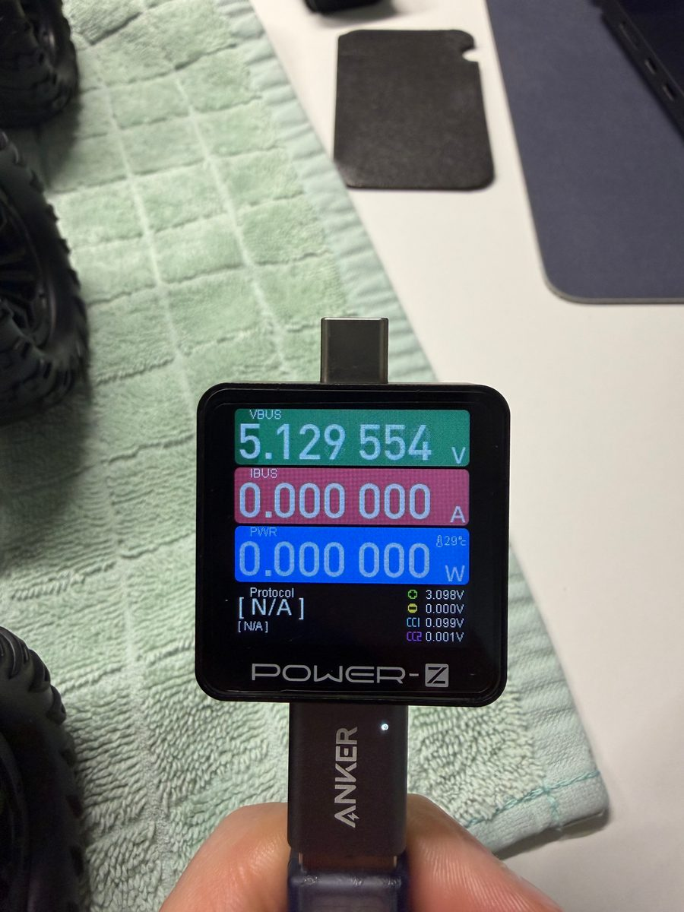
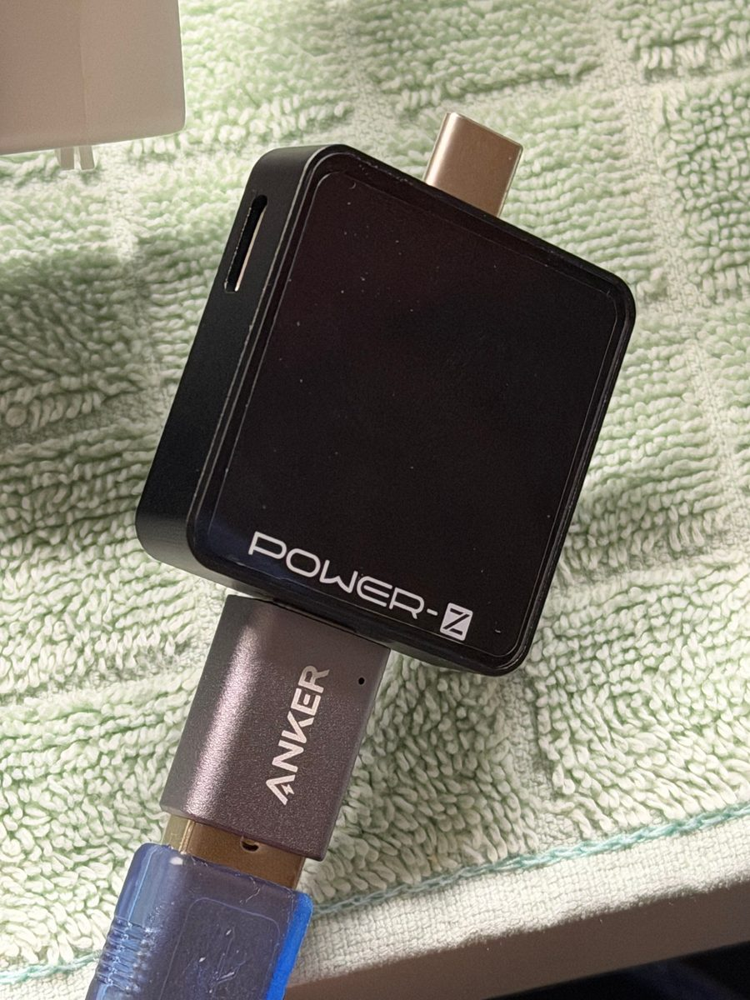
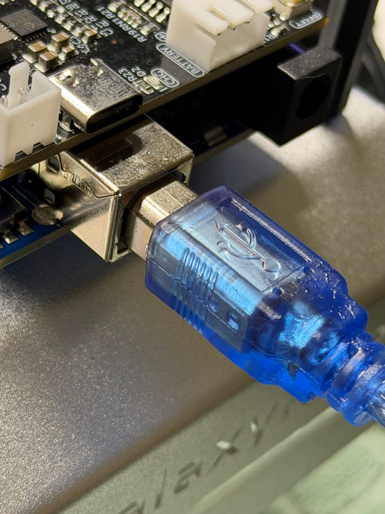

# Assembly

Coordinates and dimensions come from the build's measured specification. The [project page](https://daniel-carrera.github.io/galaxyrvr-rover-build/#model)
has a 3D model you can turn and explode.

## Steps

1. **Build the kit** with [SunFounder's assembly video](https://docs.sunfounder.com/projects/galaxy-rvr/en/v1/assemble_video.html),
   but leave off the solar panel and its mount. Its space becomes the payload deck.
2. **Print** the [lower plate and the lidar carrier](cad/): PLA, 4 wall loops, 15 % gyroid, slicer modifiers at every
   through-hole. The lower plate prints top face down; the carrier prints flat.
3. **Press four M3 nuts** into the hex pockets under the plate, for the R3 board.
4. **Fit the camera bracket and the four standoff bases** with M3 countersunk screws pointing up from under the plate,
   nuts on top. Build each standoff stack to 45 mm.
5. **Mount the Pi with the EP-0225 on it**: four M2.5 button heads up through the plate into the EP-0225's standoffs.
   Do this before the plate goes on the chassis, which covers those screw heads.
6. **Mount the R3 board and shield** under where the lidar will be, with M3 screws from the top into the captive nuts.
7. **Bolt the plate to the chassis** with four M3 screws into the chassis threads. The 21 mm channel underneath sits
   over the chassis strip, and the 8 mm hole clears its center screw.
8. **Fit the lidar** to the carrier with four M2.5 screws from below (at most 4 mm into the lidar), then screw the
   carrier onto the standoffs from above.
9. **Connect the camera** to the Pi's CAM/DISP 0 port with a 22-pin Pi 5 ribbon. Never plug it into the kit's ESP32
   camera connector: it looks similar and is not compatible.
10. **Wire it up**: lidar USB adapter to a Pi USB 2 port, wrapped in film and taped where it touches the chassis; R3 to
    the Pi with the modified cable below; power bank to the EP-0225's USB-C input. The kit's ESP32 camera is
    disconnected from the shield.
11. **Before every drive**: both batteries strapped down, loose cable coiled away from the wheels and suspension, and
    nothing in the lidar's scan plane.

## Two batteries, kept apart

```text
Rover battery ─ GalaxyRVR shield ─ R3 board + six motors
                                      │
                                      USB: data and ground only (5 V wire cut)
                                      │
Anker power bank ─ 15 V PD ─ EP-0225 ─ 5 V ─ Raspberry Pi 5 ─ camera (CSI), lidar (USB)
```

## The USB cable we cut

The Pi sends drive commands to the R3 board over USB. But the R3's USB port is also powered by the rover's battery,
through the shield. With the rover switched on and nothing else connected, a USB meter on the R3's cable read
**5.13 V**. Plugged into the Pi, that cable would have tied the rover's 5 V to the Pi's own supply, and current could
flow back into the Pi.

So on a spare USB-A to USB-B cable we opened the jacket and cut the red wire, the 5 V line (VBUS). Both cut ends were
insulated and the section taped closed. White (D−), green (D+) and black (ground) stay connected: the two boards share
data and ground, never power.

### How we checked it

Voltage with a POWER-Z KM003C USB meter; the wires with a multimeter in continuity (beep) mode, cable unplugged at
both ends. 2026-09-07.

| Check | How | Result |
|---|---|---|
| Back-feed, stock cable | Rover on, R3 → cable → meter, other end free | 5.13 V |
| Back-feed, cut cable | Same setup with the modified cable | Meter stays dark |
| 5 V end to end | A pin 1 → B pin 1 | Open |
| Ground | A pin 4 → B pin 4 | Beeps |
| Data | A pin 2 → B pin 2 (D−), A pin 3 → B pin 3 (D+) | Both beep |
| No short | 5 V to ground, at each plug | Open |
| Talks to a laptop | Laptop → cable → R3 running a test firmware with the motors disabled | 4 of 4 replies correct |
| Talks to the Pi | Pi → cable → R3, wheels off the ground | One 200 ms pulse, then stopped by itself |

<p>
  
  
  
</p>
