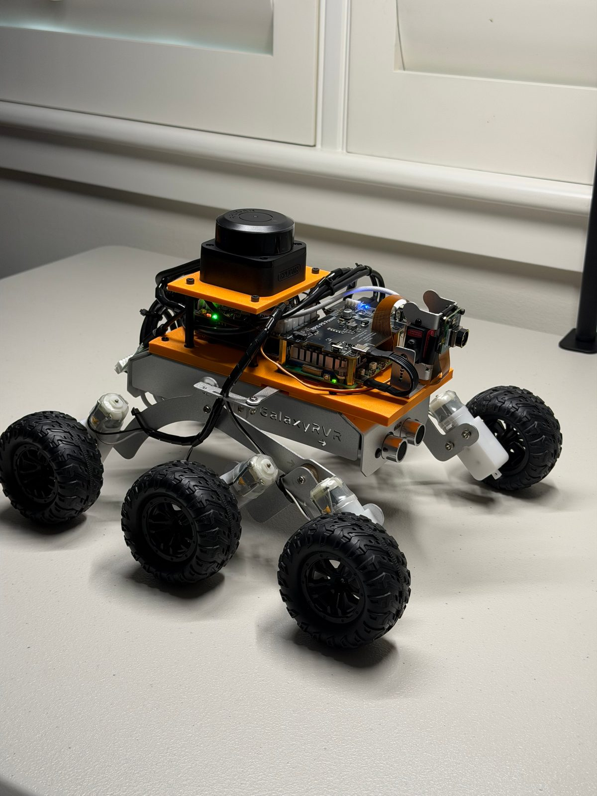
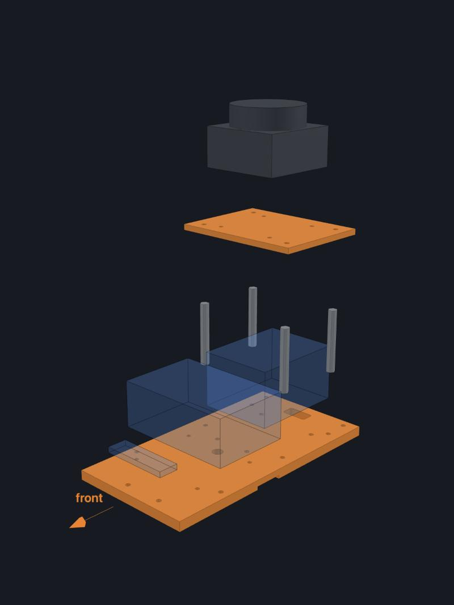

# GalaxyRVR survey rover

A SunFounder GalaxyRVR kit turned into a small survey rover: a Raspberry Pi 5, a 12 MP wide camera and a 360° lidar
on two printed PLA plates. A laptop drives it over Wi-Fi, and it can map a room and drive itself to a point on the
map. Built September to October 2026 as a learning vehicle for surveying a crawl space.

**Project page with an interactive 3D model, the lidar map and a 3D depth view:** https://daniel-carrera.github.io/galaxyrvr-rover-build/

<table>
  <tr>
    <td width="50%"></td>
    <td width="50%"></td>
  </tr>
  <tr>
    <td width="50%" align="center">The finished rover, 2026-09-12</td>
    <td width="50%" align="center">The payload exploded: printed parts in orange, boards as simple blocks</td>
  </tr>
</table>

## What is here

| | |
|---|---|
| [BOM.md](BOM.md) | Parts list with links and what we paid |
| [ASSEMBLY.md](ASSEMBLY.md) | Assembly steps, wiring, and the USB cable we modified |
| [cad/](cad/) | The two printed parts as STL (print orientation) and STEP, and the FreeCAD script that builds them |
| [docs/](docs/) | The project page (plain HTML, served by GitHub Pages); `docs/data/` holds the exported map and point cloud |

## What it has done

- **2026-09-18:** drove itself to three points on a lidar map, 1.3 to 1.7 m away, and stopped within 100 mm of each
  (77, 66 and 53 mm by tape), at 20 % power with an operator holding a dead-man key.
- **2026-09-15:** camera depth (Depth Anything V2) locked to the lidar and stitched along the drive into a 3D map
  of the room, which the page shows as an interactive point cloud.
- **2026-10-12:** first drives outdoors, over a phone hotspot with a proportional PS4 stick: two sessions, 222 s of
  driving, no faults.

## Build at a glance

- **Base:** GalaxyRVR, six TT motors, skid steer. Solar panel left off; its space is the payload deck.
- **Computer:** Raspberry Pi 5 (8 GB) on its own battery (Anker power bank → 52Pi EP-0225 → 5 V).
- **Sensors:** Arducam IMX708 12 MP 120° camera; SLAMTEC RPLIDAR C1, scan plane 183 mm above the floor.
- **Link:** Pi to the kit's R3 board over USB, with the cable's 5 V wire cut so the two batteries never meet.
- **Software:** plain Python, no ROS. Not published in this repository yet.

## License

MIT, for the CAD, the page, the photos and the text. See [LICENSE](LICENSE). The page serves a copy of
[three.js](https://threejs.org/) (MIT) from `docs/js/vendor/`.
